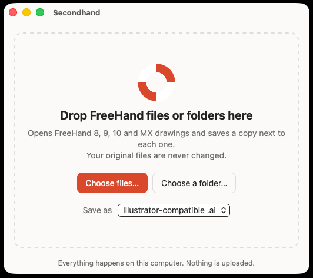
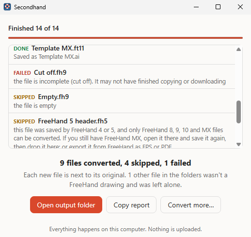
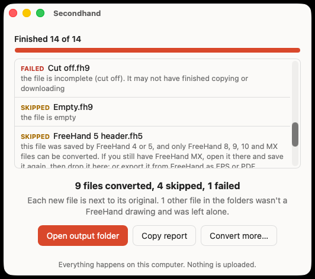
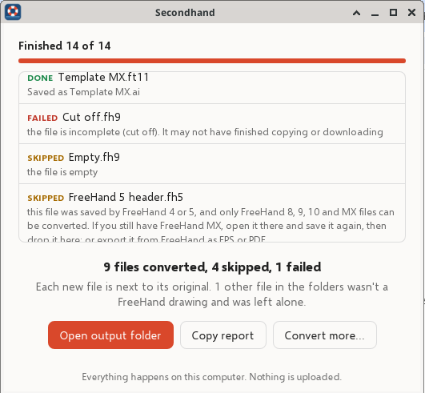

# Secondhand

**Drop old FreeHand drawings in, get `.ai` files out.** Secondhand opens FreeHand 8, 9, 10 and MX
(11) documents and templates and saves a copy that current Adobe Illustrator opens directly. It
also saves PDF or SVG if you'd rather.

## Download and install

**[⬇ Download the latest version](https://github.com/realwitt/secondhand/releases/latest)**

| Computer | Download |
|---|---|
| **Mac** (Apple silicon M1–M4 and Intel) | [Secondhand_0.1.0_universal.dmg](https://github.com/realwitt/secondhand/releases/latest/download/Secondhand_0.1.0_universal.dmg) (or the [zipped app](https://github.com/realwitt/secondhand/releases/latest/download/Secondhand_0.1.0_universal.app.zip)) |
| **Windows** 10 or 11 | [Secondhand_0.1.0_x64-setup.exe](https://github.com/realwitt/secondhand/releases/latest/download/Secondhand_0.1.0_x64-setup.exe) (installer). Also: [.msi](https://github.com/realwitt/secondhand/releases/latest/download/Secondhand_0.1.0_x64_en-US.msi), or the [portable .exe](https://github.com/realwitt/secondhand/releases/latest/download/Secondhand_0.1.0_x64_portable.exe) (no install) |

Secondhand isn't signed with a paid Apple or Microsoft developer certificate, so the first time you
open it your computer will ask whether you trust it. It only takes a minute:

### Mac: the first time you open Secondhand

1. Open the `.dmg` and drag **Secondhand** into **Applications**.
2. Double-click Secondhand. macOS says *"Secondhand" Not Opened* (or *can't be opened because Apple
   cannot check it for malicious software*). Click **Done** (not *Move to Trash*).
3. Open **System Settings ▸ Privacy & Security** and scroll down to the **Security** section. You'll see:

   ```
   ┌───────────────────────────────────────────────────────────────┐
   │ Security                                                      │
   │                                                               │
   │ "Secondhand" was blocked to protect your Mac.   [ Open Anyway ] │
   └───────────────────────────────────────────────────────────────┘
   ```

4. Click **Open Anyway**, type your Mac password (or use Touch ID), then click **Open Anyway**
   once more in the box that appears.

That's it. From then on, Secondhand opens like any other app. (On macOS 14 and earlier you can
also right-click Secondhand in Applications, choose **Open**, then **Open**.)

### Windows: the first time you run Secondhand

Windows SmartScreen may show a blue box, *Windows protected your PC*:

```
┌──────────────────────────────────────────────┐
│ Windows protected your PC                    │
│                                              │
│ Microsoft Defender SmartScreen prevented an  │
│ unrecognized app from starting...            │
│ More info  ◀── 1. click this                 │
│                                              │
│                 [ Run anyway ] ◀── 2. then this
└──────────────────────────────────────────────┘
```

Click **More info**, then **Run anyway**. You only need to do this once.

## What it does

<p align="center">&nbsp;</p>

- **Drop files or whole folders** on the window, or on the app's icon in the Dock or Finder (Mac),
  or click **Choose files…**. Folders are searched all the way down, so you can drop a whole
  archive at once.
- **Your originals are never changed.** Each new file is saved next to its original, as
  `Name.ai`. If `Name.ai` already exists, Secondhand saves `Name (1).ai` and so on. It never writes
  over anything.
- **One bad file doesn't stop the batch.** At the end you get a list of what was converted, what
  was skipped and what failed, each with a reason in plain English.
- **Everything stays on your computer.** Secondhand never connects to the internet.

Secondhand is free and open source (MIT OR Apache-2.0). It is not made by or affiliated with Adobe.
FreeHand and Illustrator are trademarks of Adobe; they are named here only to say which files
Secondhand reads and writes.

## Using Secondhand

1. Open Secondhand. A small window says **Drop FreeHand files or folders here**.
2. Drag FreeHand files or folders onto it, or click **Choose files…** (or **Choose a folder…**).
   On a Mac you can also drop them straight onto Secondhand's icon in the Dock or in Applications.
3. Watch each file go by:

   

   When it's done, click **Open output folder** to see the new files.
   **Copy report** copies the list of what happened, which is handy if you want to ask someone
   about a file that failed.

**Save as** at the bottom of the window picks the kind of file to make:

- **Illustrator-compatible .ai** (the default) is what most people want. Illustrator opens it
  directly with File ▸ Open, keeping the pages and layers.
- **PDF** opens anywhere: Illustrator, Acrobat, Preview, Affinity, Inkscape.
- **SVG** makes one file per FreeHand page, for the web or other apps.

Secondhand looks for files ending in `.fh8`, `.fh9`, `.fh10`, `.fh11`, `.fh`, `.ft8`–`.ft11`, plus
old Mac files that have no extension at all (it checks what's inside them). Other files in a
dropped folder are left alone.

### What comes across, and what doesn't

| In FreeHand | In the `.ai` / PDF |
|---|---|
| Pages | **Artboards** (one PDF page per FreeHand page), same size |
| Layers, in order, with their names | **Layers** (PDF layers). Hidden layers stay hidden, with everything on them |
| Paths, compound paths, groups, clipping (paste inside) | Kept as editable vector paths, groups and clipping groups |
| Rectangles (also rounded), ellipses, polygons, stars | Editable paths with the same shape |
| Fill and stroke colours, stroke widths, dashes | Kept. Process, spot and tint colours become RGB |
| Linear and radial gradients | Kept as gradients |
| Symbols (instances) | The symbol's artwork, placed as it was |
| Text | Best effort: the words, font, size and colour. Text that was already converted to outlines is exact |

These are **changed** (each one is listed as a note next to the file when it happens):

- Pattern, PostScript and custom fills become a solid colour. Lens fills become a flat colour.
  Tile fills come out empty.
- Conic gradients become linear and contour gradients become radial.
- Blends keep their steps as they were drawn. They are no longer live blends.
- Arrowheads, brushes, envelopes, perspective grids, shadows, glows and other effects are left off.
  Line caps and corners come out butt and mitred.
- Placed (imported) images are left out, and guides aren't kept.
- Symbols arrive as normal artwork, not as Illustrator symbols.

**Not supported:** FreeHand 7 and earlier (1–5, 7). Secondhand recognises them and tells you which
version the file is. If you still have FreeHand MX, open the file there, save it, and drop it on
Secondhand again.

Under the hood, the `.ai` file is a "PDF-compatible" Illustrator file: a PDF 1.7 with one page
per artboard and the layers as PDF optional-content layers. Illustrator's own `.ai` files are
built the same way (a PDF, plus Illustrator's private editing data, which isn't publicly
documented and isn't written here). Illustrator opens such a file by reading its PDF part, so
the drawing comes in as editable paths. The **PDF** choice writes exactly the same file with a
`.pdf` name.

## For developers

Secondhand is a small Rust workspace on top of the [VectorCraft](https://github.com/storytold/vectorcraft)
engine, which reads the FreeHand file and writes the `.ai`/PDF/SVG:

```
crates/secondhand-core    finding files, converting one at a time, safe naming, the summary
crates/secondhand-cli     secondhand-cli [--format ai|pdf|svg] [--json REPORT.json] PATH…
app/                      the desktop app (Tauri 2): ui/ is plain HTML/JS, src-tauri/ the Rust side
tools/make-fixtures       writes the synthetic test drawings in fixtures/
scripts/check_outputs.py  validates outputs with qpdf (via pikepdf), and checks each .ai's
                          layers (one PDF layer per layer, top-first order, hidden ones off)
                          and page boxes
```

```sh
cargo test -p secondhand-core
cargo run -p secondhand-cli -- fixtures/            # converts the test drawings in place
cd app/src-tauri && npx @tauri-apps/cli@2 build   # the desktop app (Linux needs webkit2gtk-4.1)
```

The desktop app also has a headless batch mode, used by CI on each platform:
`Secondhand --batch [--format ai] [--report report.json] PATH…`.

**Test files.** Everything in `fixtures/` is synthetic: the files are built byte by byte by
VectorCraft's `synth` module (`cargo run -p make-fixtures -- fixtures`). No real FreeHand drawing is
in this repository, and none should be added.

### The VectorCraft dependency, and switching to upstream

FreeHand import was added to VectorCraft in
[storytold/vectorcraft#2075](https://github.com/storytold/vectorcraft/pull/2075). Until that is
merged, `Cargo.toml` pins the VectorCraft crates to that branch's commit on the fork:

```toml
vectorcraft-engine = { git = "https://github.com/realwitt/vectorcraft", rev = "6db207b0b9b89eeb7a6865f1f4a1ff6ffac2e7c4" }
```

Once #2075 is merged, point the three `vectorcraft-*` lines at upstream, using the merge commit
(or a release tag that includes it), then run `cargo update -p vectorcraft-engine` and the tests:

```toml
vectorcraft-engine = { git = "https://github.com/storytold/vectorcraft", rev = "<merge commit>" }
```

CI also builds the app and the command-line tool on Linux, for testing; they are kept as workflow
artifacts, not release downloads:

<p align="center"></p>

## License

Secondhand is licensed under either of [MIT](LICENSE-MIT) or [Apache-2.0](LICENSE-APACHE), at your
option. It is built on VectorCraft (© ArtCraft Team and the VectorCraft contributors, MIT OR
Apache-2.0) and bundles the fonts and other third-party material listed in
[THIRD-PARTY-NOTICES.md](THIRD-PARTY-NOTICES.md). Those notices and license texts ship inside the
app too.
